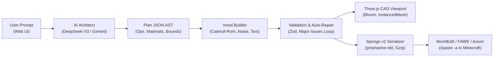

<div align="center">


# ⚡ BlockArchitect AI
### Next-Gen Parametric 3D Voxel CAD Studio & Minecraft Architecture Engine

[](https://github.com/averagekar/blockarchitect/stargazers)
[](https://opensource.org/licenses/MIT)
[](https://nodejs.org/)
[](https://react.dev/)
[](https://threejs.org/)
[](https://deepseek.com)
[](https://enginehub.org/worldedit)

<p align="center">
  <b>Transform natural language prompts into monumental, organic 3D Minecraft structures, colossal dragon sculptures, and competitive ArenaPvP hubs in seconds.</b><br>
  Built with high-density Three.js InstancedMesh rendering, cinematic bloom post-processing, and 1-click Sponge Schematic v2 export for WorldEdit & FAWE.
</p>

[**🚀 Quickstart**](#-quickstart) • [**✨ Key Features**](#-key-features) • [**🏗️ Architecture**](#️-engine-architecture) • [**🎮 Presets**](#-architectural-presets) • [**📦 WorldEdit Guide**](#-server-deployment-guide) • [**🗺️ Roadmap**](#-roadmap)

---

</div>

## 🌟 Why BlockArchitect?

Most AI Minecraft generators produce flat, hollow, simplistic quartz boxes. **BlockArchitect** was engineered with a 30-year master architectural sculptor philosophy, equipped with parametric 3D curves, catenary arches, organic wing membranes, volumetric simplex terrain, and 3D extruded voxel typography.

```
Traditional AI Builders                BlockArchitect Studio
┌─────────────────────────┐            ┌─────────────────────────────────────────┐
│ ❌ Boxy, flat surfaces   │     vs     │ 💎 Smooth 3D Splines & Ellipsoids       │
│ ❌ Single monotone block│            │ 🎨 WorldEdit % Dithering Gradients      │
│ ❌ Empty inside void    │            │ 🐉 Complex Organic Anatomy (Dragons)   │
│ ❌ Clunky web forms     │            │ ⚡ Tripartite CAD Studio + AAA Bloom     │
│ ❌ Fragile NBT parsing  │            │ 📦 Sponge Schematic v2 (FAWE & Axiom)   │
└─────────────────────────┘            └─────────────────────────────────────────┘
```

---

## ✨ Key Features

### 🧠 Dual-Engine AI Reasoning (DeepSeek-V3 + Gemini 3.8)
- **DeepSeek-V3 Powered:** High-reasoning spatial planning, procedural geometry tree generation, and self-repair loops (`repairPrompt`).
- **Gemini 3.8 Flash Fallback:** High-speed parallel generation with automatic failover routing.
- **Parametric Geometric Primitives:**
  - `curve`: 3D Catmull-Rom spline tubes (dragon necks, horns, curled tails).
  - `text_3d`: 3D voxel bitmap typography (A–Z, 0–9) with customizable scale, extrusion depth, outer borders, and arch curvature.
  - `membrane`: 3D triangular surface meshes with barycentric interpolation (dragon wings, sails).
  - `tapered_cylinder` & `cone_3d`: Arbitrary 3D angle cones (breathing fire, spires, horns).
  - `terrain`: FBM 3D Simplex noise natural rock formations and volcanic ridges.
  - `pattern`: WorldEdit-compatible weighted percentages (`60%blackstone,30%deepslate_tiles,10%magma_block`) and Y-axis height gradients.

### 🖥️ Tripartite CAD Workstation UI/UX
- **Always-On 3D Viewport:** Instant WebGL stage with interactive 16×16 chunk grid, holographic coordinate compass, and orientation axes.
- **Real-Time Voxel Raycasting:** Hover over any block to inspect its Minecraft ID, global coordinates `[X, Y, Z]`, and vertical layer height.
- **AAA Cinematic Post-Processing:** Powered by `@react-three/postprocessing` Bloom — Shroomlight dragon eyes, Magma cracks, Crying Obsidian runes, and Lava cascades realistically glow in the dark!
- **Vertical Layer Slicer (HUD):** Interactive vertical scrub bar to slice and inspect the building layer-by-layer (`Y = 0` to `Y = Max`).
- **Tactile Framer Motion Physics:** Spring-damped folding drawers, gliding pill tabs (`layoutId`), and celebratory `canvas-confetti` on schematic completion.

### 📦 Seamless Minecraft Server Integration
- **Sponge Schematic v2 (.schem):** Strict NBT compound serialization with gzip compression compatible with WorldEdit, FastAsyncWorldEdit (FAWE), Axiom, and Litematica.
- **1-Click Paste Commands:** Instant copy for `//schem load <name>` and `//paste -a` with immediate clipboard feedback.

---

## 🏗️ Engine Architecture



---

## 🚀 Quickstart

### Prerequisites
- **Node.js** >= `20.6`
- **npm** >= `9.0`
- A **DeepSeek API Key** ([platform.deepseek.com](https://platform.deepseek.com)) or **Google AI Studio Key** ([aistudio.google.com](https://aistudio.google.com/apikey))

### 1. Clone & Install
```bash
git clone https://github.com/averagekar/blockarchitect.git
cd blockarchitect
npm run install:all
```

### 2. Configure Environment
Create `server/.env` based on `server/.env.example`:
```bash
cp server/.env.example server/.env
```

Edit `server/.env`:
```env
# DeepSeek API (Primary)
DEEPSEEK_API_KEY=your_deepseek_api_key_here
DEEPSEEK_MODEL=deepseek-chat
AI_PROVIDER=deepseek

# Google AI Studio (Optional / Failover)
GEMINI_API_KEY=your_gemini_api_key_here
GEMINI_MODEL=gemini-3.8-flash

PORT=8787
CORS_ORIGIN=http://localhost:5173
MC_DATA_VERSION=3955
```

### 3. Launch Development Studio
```bash
npm run dev
```

Open your browser at **`http://localhost:5173`**. The 3D CAD canvas will initialize immediately.

---

## 🎮 Architectural Presets

| Blueprint | Category | Dimensions | Highlights |
| :--- | :---: | :---: | :--- |
| **Hardcore PvP Hub & 3D "NOVA" Logo** | `Spawn Citadel` | 180×80×180 | 3D block lettering, twin flanking dragons, volcanic peaks, smooth obstacle-free PvP arena. |
| **Colossal Blue Dragon & Flame Cone** | `Organic Sculpture` | 70×40×60 | S-shaped spine, bone block teeth, membrane glass wings, 25-block conical fire plume. |
| **Gothic Cathedral & Flying Buttresses** | `Monumental` | 50×55×80 | Flying buttresses, rose window, twin spires, ribbed vault ceilings, suspended lanterns. |
| **Traditional 3-Tier Japanese Pagoda** | `Eastern Landscape` | 25×38×25 | Curved eaves, red concrete columns, stone foundation pedestal, cherry blossom grove. |

---

## 📦 Server Deployment Guide

To paste structures directly into your Minecraft server (Paper, Purpur, Fabric, Spigot):

1. **Download Schematic:** Click the **`.schem İndir`** button in the top ribbon or right inspector.
2. **Upload to Server:** Place the downloaded `.schem` file into:
   ```
   plugins/WorldEdit/schematics/
   # or for FastAsyncWorldEdit:
   plugins/FastAsyncWorldEdit/schematics/
   ```
3. **Execute In-Game:**
   ```bash
   //schem load <filename>
   //paste -a
   ```
   *(The `-a` flag skips air blocks to seamlessly merge with existing terrain!)*

---

## 🗺️ Roadmap

- [x] High-performance InstancedMesh voxel rasterizer (up to 1,000,000 voxels)
- [x] 3D Catmull-Rom spline curves & organic membrane surfaces
- [x] 3D Voxel typography engine (`text_3d`) with arched lettering
- [x] DeepSeek-V3 & Gemini 3.8 multi-provider engine with auto-failover
- [x] Cinematic Bloom & Vignette post-processing pipeline
- [x] Gliding pill tabs, CAD constraints controls, and category palette filters
- [ ] **Texture Atlas Shader:** Real 16×16 Minecraft block textures mapped via UV atlas
- [ ] **Direct RCON / WebSocket Server Link:** Instant in-game spawn without downloading files
- [ ] **Multi-Layer Schematic Slicing:** Export blueprint layers as step-by-step Litematica schematics
- [ ] **Multiplayer Collaborative Studio:** Real-time WebRTC room sharing

---

## 🤝 Contributing

Contributions make the open-source community thrive! Any contributions you make are **greatly appreciated**.

1. Fork the Project
2. Create your Feature Branch (`git checkout -b feature/AmazingFeature`)
3. Commit your Changes (`git commit -m 'feat: Add some AmazingFeature'`)
4. Push to the Branch (`git push origin feature/AmazingFeature`)
5. Open a Pull Request

---

## 📄 License

Distributed under the **MIT License**. See `LICENSE` for more information.

<div align="center">
  <sub>Crafted with passion for Minecraft builders, architects, and server developers worldwide.</sub>
</div>
